# Instrukcja administratora serwisu szkolenia.iskt.pl

Ta instrukcja prowadzi krok po kroku przez czynności dostępne w panelu pod adresem `/panel`.

> **Stan dokumentu.** Treść opisuje panel w wersji V1 — stan gałęzi `main` na commicie `9ae7205`. Poprzednia wersja instrukcji powstała przed redesignem V1 (commit `9469014`, 2026-10-09) i opisywała panel, którego już nie ma; ISK-427 doprowadził tekst do stanu faktycznego.
>
> **Zrzuty ekranu odświeżono 2026-10-23** z tego samego stanu kodu, na lokalnym środowisku z danymi demonstracyjnymi. Odtwarza je `tests/e2e/zrzuty-instrukcji.spec.ts` — patrz §10.

Panel ma **własną powłokę**: nie widać w nim publicznego nagłówka ani stopki serwisu. U góry znajdziesz link **ISKT Panel** (wraca na pulpit), nawigację obszarów, adres zalogowanego konta oraz przycisk **Wyloguj**. Nawigacja panelu ma trzy pozycje: **Szkolenia**, **Trenerzy** i **Zgłoszenia**. Pulpit nie jest osobną zakładką — wracasz na niego linkiem **ISKT Panel**.

## 1. Logowanie

1. Otwórz adres serwisu zakończony `/panel`.
2. Jeśli nie masz aktywnej sesji, panel sam przeniesie Cię do formularza logowania.
3. Wpisz służbowy adres e-mail administratora i hasło przekazane przez osobę opiekującą się dostępem.
4. Wybierz **Zaloguj się**. Na czas sprawdzania przycisk zmienia napis na **Logowanie…** i jest nieaktywny, więc nie wyślesz tego samego zgłoszenia dwa razy.

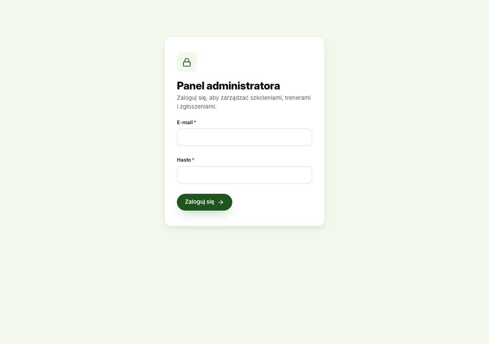

Gdy któreś pole jest puste lub ma zły format, komunikat pojawia się **przy tym polu**. Gdy sam adres i hasło nie pasują do konta, nad przyciskiem pojawia się komunikat „Nie udało się zalogować. Sprawdź dane i spróbuj ponownie.” — czytnik ekranu ogłasza go od razu. Po nieudanej próbie **oba pola zostają wyczyszczone** — wpisz adres i hasło od nowa. Nie wysyłaj hasła e-mailem ani komunikatorem. Gdy dostęp nadal nie działa, poproś opiekuna technicznego o sprawdzenie konta administratora.

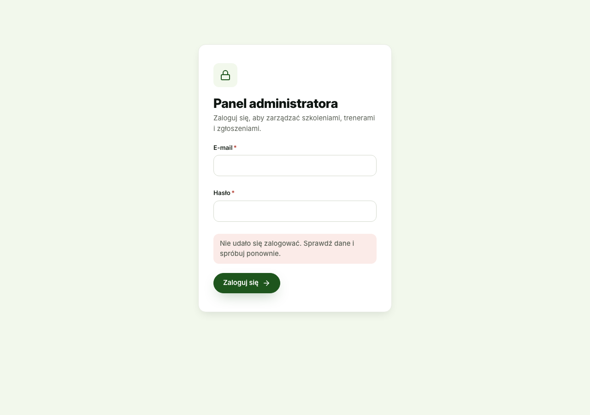

Po poprawnym logowaniu zobaczysz pulpit: nagłówek **Zarządzanie ofertą** i trzy karty skrótów — **Szkolenia**, **Trenerzy**, **Zgłoszenia**.

Po zakończeniu pracy wybierz **Wyloguj**. Jest to szczególnie ważne na współdzielonym komputerze.

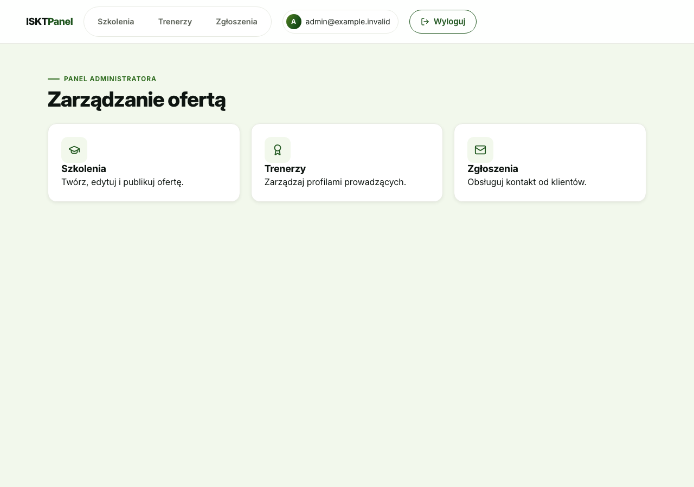

## 2. Trenerzy

Warto zacząć od trenerów, aby można ich było od razu przypisać do szkolenia.

### Dodanie trenera

1. Wejdź w **Trenerzy** i wybierz **Dodaj trenera**.
2. Uzupełnij **Imię i nazwisko**.
3. Uzupełnij pole **Slug** krótkim adresem bez spacji i polskich znaków, np. `anna-kowalska`. To fragment adresu internetowego profilu. Panel nie tworzy go automatycznie z nazwiska — wpisz go sam.
4. Uzupełnij **Nagłówek**, **Biogram** oraz **Kompetencje (po przecinku)**.
5. Opcjonalnie wklej w pole **URL zdjęcia** pełny adres zaczynający się od `https://`. Pod polem panel przypomina: „Upload plików nie jest dostępny w MVP” — zdjęcia z dysku wgrać nie można.
6. Pole **Kolejność** decyduje o miejscu osoby na publicznej liście: mniejsza liczba oznacza wyżej.
7. Wybierz **Zapisz trenera**. Nowa osoba pojawi się jako **Szkic**.


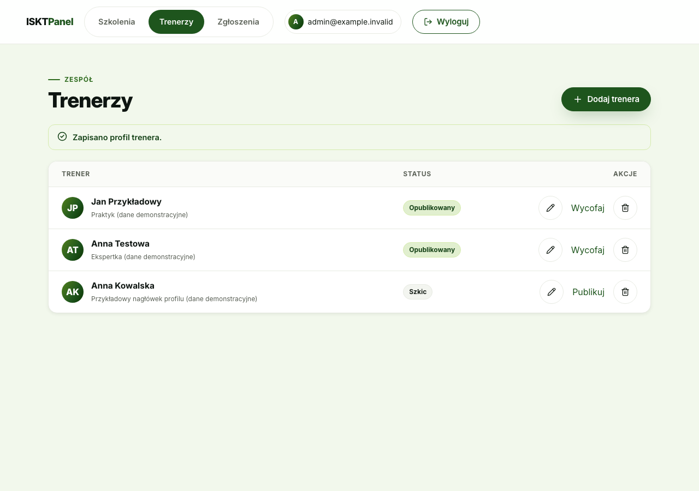

### Edycja i publikacja trenera

W wierszu wybranej osoby kliknij ikonę ołówka (**Edytuj**), zmień dane i ponownie wybierz **Zapisz trenera**. Z edytora wracasz linkiem **Wróć do listy**. Aby profil był widoczny dla odwiedzających, na liście wybierz **Publikuj**. Przycisk zmieni się na **Wycofaj**.

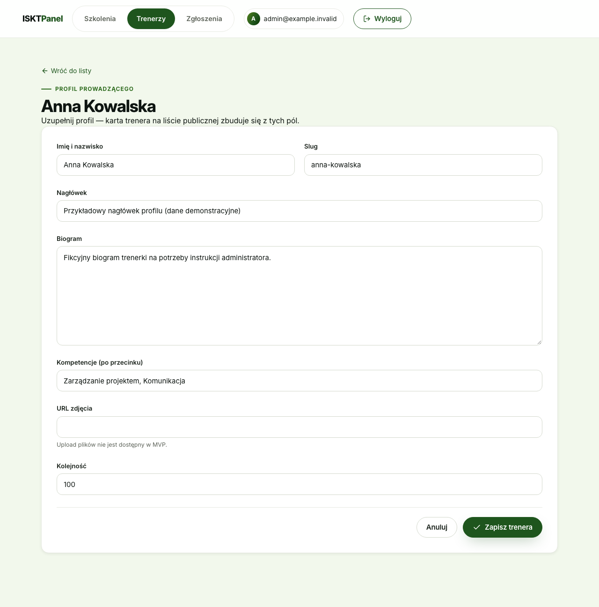

Zdjęcie jest opcjonalne. Bez niego publiczna lista pokazuje kółko z inicjałami osoby, a obok imię i nazwisko, nagłówek, kompetencje i biogram — nie ma pustego ani uszkodzonego obrazka.

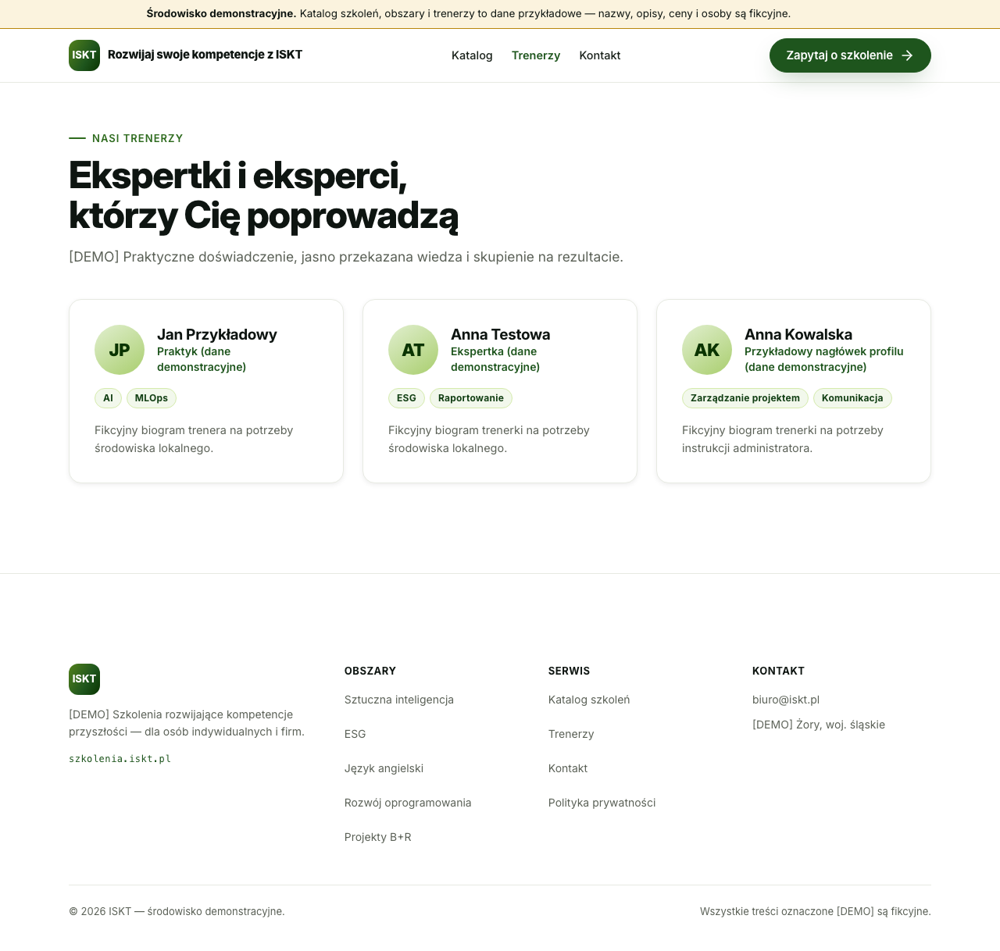

Przed publikacją zdjęcia upewnij się, że ISKT ma prawo do wykorzystania wizerunku oraz samego pliku. Nie używaj przypadkowych zdjęć znalezionych w internecie.

## 3. Szkolenia: dodanie, szkic i edycja

### Dodanie szkolenia

1. Wejdź w **Szkolenia** i wybierz **Dodaj szkolenie**.
2. Podaj **Tytuł** oraz **Slug**, czyli fragment adresu bez spacji i polskich znaków, np. `zarzadzanie-projektem`. Tak jak u trenerów, slug wpisujesz sam.
3. Wpisz **Podsumowanie** widoczne na liście oraz dłuższy **Opis**.
4. Wybierz **Kategorię** i **Poziom**. Listę kategorii prowadzisz sam — patrz „Kategorie” poniżej.
5. Podaj **Czas (godz.)** i **Cenę netto PLN**.
6. W polu **Czego się nauczysz** wpisz korzyści — jedną w wierszu. Puste pole ukrywa tę sekcję na publicznej stronie, więc nie zostaje po niej pusty nagłówek. W **Dla kogo** opisz odbiorców.
7. W **Najbliższe terminy** możesz dopisać terminy. Niżej zaznacz **Dostępne dofinansowanie** i uzupełnij **Informację o dofinansowaniu**, jeśli dotyczy.
8. Zaznacz **Pokaż w sekcji „Szkolenia, które wyróżniamy” na stronie głównej**, jeśli szkolenie ma trafić do tej sekcji.
9. **Tytuł SEO** (do 70 znaków) i **Opis SEO** (do 160 znaków) są widoczne w wynikach wyszukiwania. Puste pola oznaczają, że wyszukiwarka pokaże nazwę szkolenia i jego krótki wstęp.
10. W sekcji **Trenerzy** zaznacz osoby prowadzące. Można wybrać więcej niż jedną.
11. Pole **Kolejność** ustawia miejsce pozycji w katalogu: mniejsza liczba oznacza wyżej. Nowe szkolenie startuje ze `100`.
12. Wybierz **Zapisz szkolenie**. Obok stoi **Anuluj**, który wraca na listę bez zapisu.

Rozbudowany program szkolenia (sekcje z punktami) nie ma pola w panelu — do jego wprowadzenia potrzebny jest kontakt z wykonawcą. Dopóki jest pusty, publiczna strona po prostu nie pokazuje sekcji „Program szkolenia”.

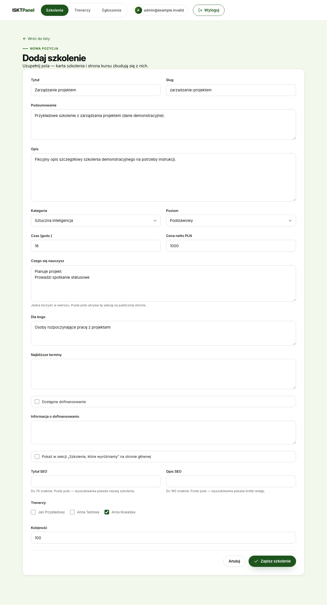

Nowa pozycja zostaje zapisana jako **Szkic**. Dzięki temu możesz dokończyć treść później, a odwiedzający jeszcze jej nie zobaczą.

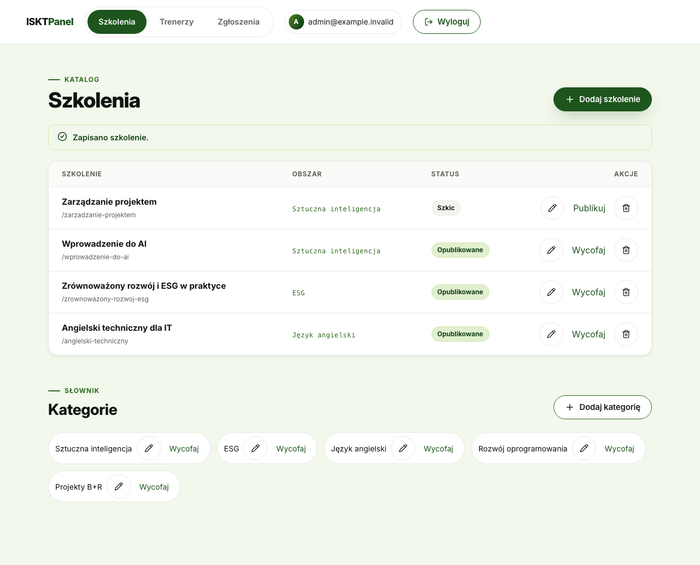

### Edycja szkolenia

Na liście szkoleń kliknij ikonę ołówka (**Edytuj**) przy właściwym wierszu. Zmień dane, kategorię lub zaznaczenie trenerów, a następnie wybierz **Zapisz szkolenie**. Panel zachowuje przypisane wcześniej osoby — sprawdź zaznaczenia przed zapisem.

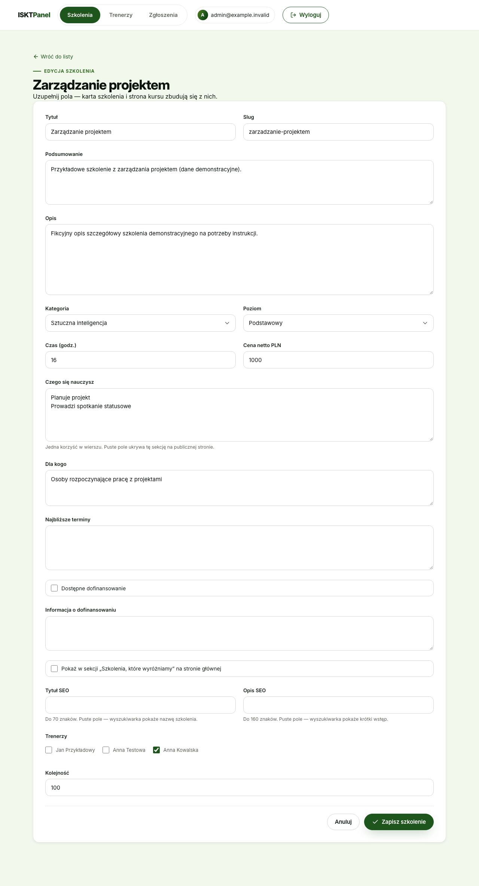

### Kategorie

Kategorie prowadzisz z tej samej strony co szkolenia. Pod tabelą znajdziesz sekcję **Kategorie** (podpisaną „Słownik”) z listą kategorii w formie pastylek.

- **Dodaj kategorię** otwiera edytor nowej kategorii; zapisujesz ją przyciskiem **Zapisz kategorię**.
- Ikona ołówka przy pastylce otwiera edycję istniejącej kategorii.
- **Publikuj** / **Wycofaj** przy pastylce decyduje, czy kategoria jest widoczna na publicznych stronach.

Kategorii **nie da się usunąć z panelu**. Jeśli kategoria jest już niepotrzebna, wycofaj ją; trwałe usunięcie wymaga kontaktu z wykonawcą.

## 4. Publikacja i wycofanie

W każdym wierszu listy szkoleń i trenerów stoją trzy operacje: ikona ołówka (**Edytuj**), tekstowy przycisk **Publikuj** albo **Wycofaj** oraz ikona kosza (**Usuń**).

Po **zapisaniu formularza** pojawia się zielony pasek potwierdzenia — czytnik ekranu ogłasza go jako komunikat stanu. Dotyczy to czterech operacji: „Zapisano szkolenie”, „Zapisano profil trenera”, „Zapisano kategorię” i „Zapisano notatkę wewnętrzną”. Pasek jest jednorazowy: po odświeżeniu strony (F5, powrót do zakładki) nie wraca, więc nie potwierdza omyłkowo zmiany, której nie było.

**Publikacja, wycofanie i usunięcie paska nie pokazują.** Potwierdzeniem jest tu sama tabela: zmieniony znacznik statusu (**Szkic** / **Opublikowane**) albo zniknięcie wiersza. Jeśli po kliknięciu nic się nie zmieniło, operacja się nie powiodła — odśwież stronę i spróbuj ponownie.

### Publikacja

Na liście szkoleń wybierz **Publikuj**. Status zmieni się ze **Szkic** na **Opublikowane**. Publikacja i wycofanie działają od razu, bez pytania o potwierdzenie — są odwracalne jednym kliknięciem.

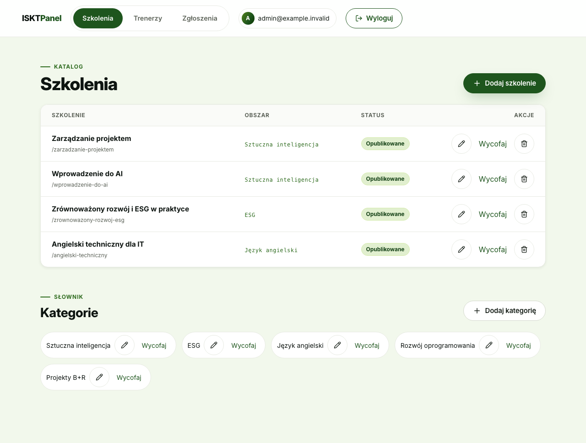

Od tej chwili odwiedzający mogą znaleźć szkolenie w katalogu i otworzyć jego publiczną stronę. Widzą między innymi tytuł, opis, kategorię, poziom, czas, cenę, terminy i przypisanych opublikowanych trenerów.

Gdy **Najbliższe terminy** zostawisz puste, strona publiczna pisze w tym miejscu „Terminy ustalane indywidualnie” — nie zostaje pusta rubryka. Jeśli chcesz podać konkretne daty, uzupełnij to pole w edytorze.

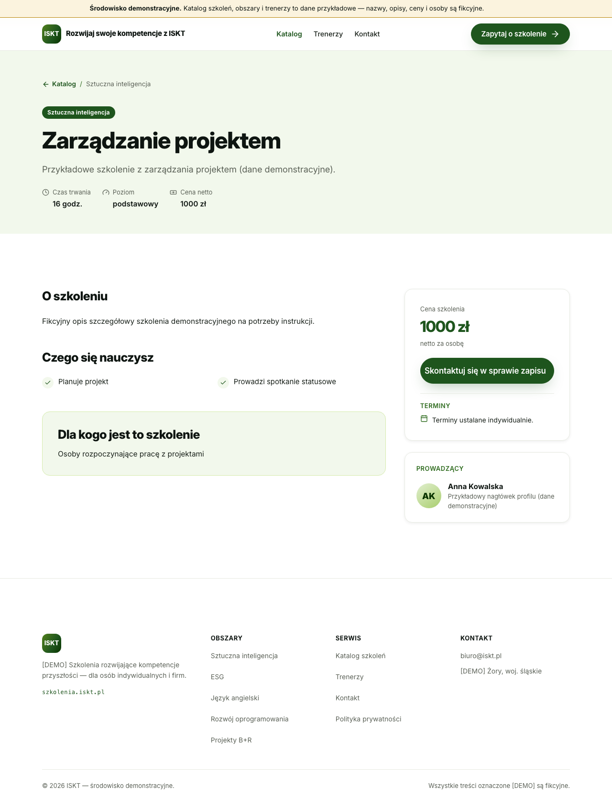

Panel odświeża zapamiętaną wersję katalogu po zmianie. W codziennej pracy po publikacji otwórz publiczną stronę lub ją odśwież. Jeśli zmiana nie pojawi się od razu, odczekaj chwilę i odśwież ponownie. Publiczne strony mają dodatkowo automatyczne odświeżenie co 5 minut.

### Wycofanie

Przy opublikowanym szkoleniu wybierz **Wycofaj**. Status wróci do **Szkic**.

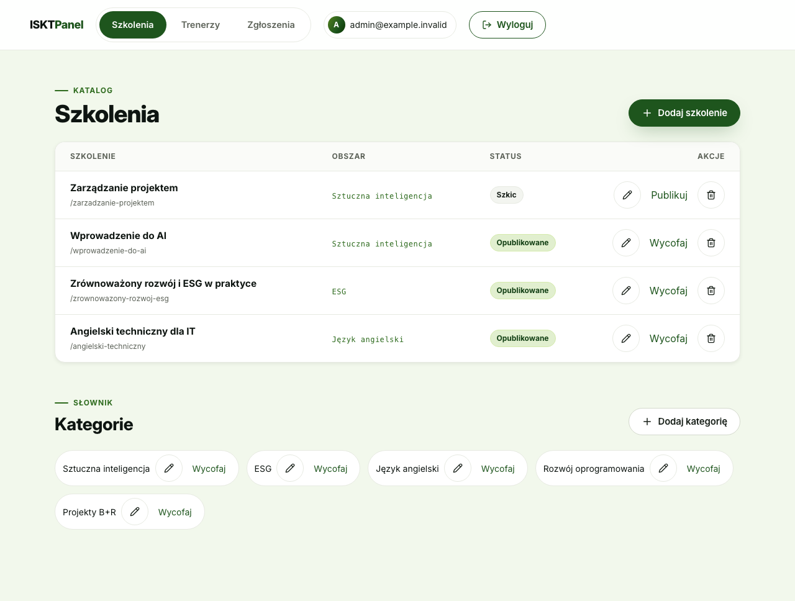

Po wycofaniu pozycja znika z katalogu, a jej dotychczasowy adres pokazuje stronę „Nie znaleźliśmy tego szkolenia” z wyjaśnieniem „Szkolenie nie istnieje albo nie zostało opublikowane” i przyciskiem **Wróć do katalogu**. Osoba, która ma jeszcze starą stronę otwartą w karcie, musi ją odświeżyć.

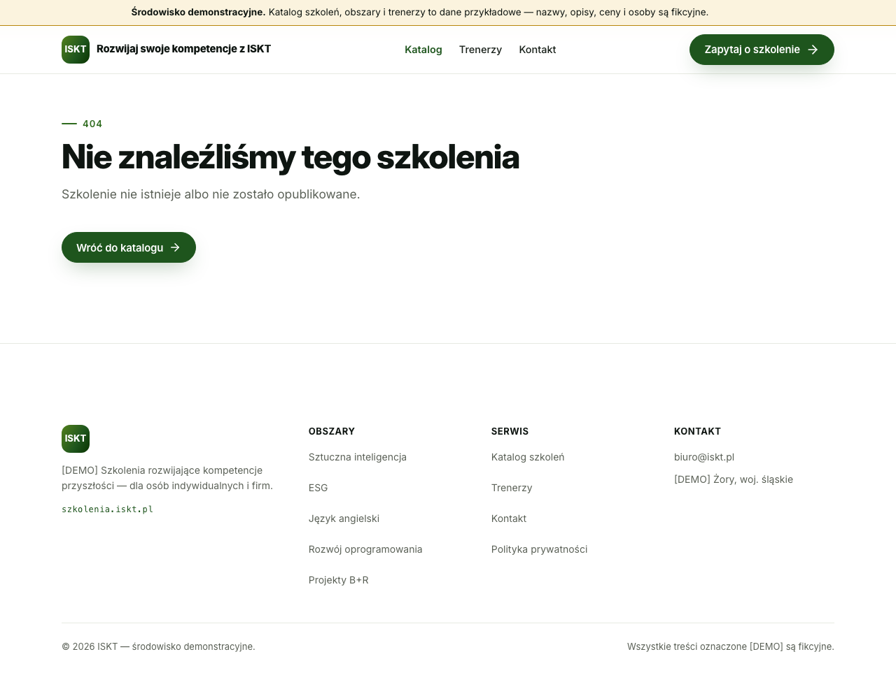

Wycofanie nie usuwa treści. Nadal możesz ją poprawić w panelu i opublikować ponownie.

### Usunięcie — pytanie o potwierdzenie

**Usuń** kasuje pozycję trwale, dlatego panel pyta o potwierdzenie w dwóch krokach:

1. Kliknięcie ikony kosza **zamienia przyciski w tym wierszu** na pytanie: „Usunąć szkolenie _nazwa_? Tej operacji nie można cofnąć”. Pytanie pojawia się w samym wierszu — nie jest osobnym okienkiem.
2. Wybierz **Tak, usuń trwale**, aby usunąć, albo **Anuluj**, aby wrócić.

Pytanie można odwołać klawiszem **Escape**. Po otwarciu pytania fokus klawiatury stoi na **Anuluj** (nie na przycisku niszczącym), a po rezygnacji wraca na ikonę kosza. Dopóki pytanie jest otwarte, Tab krąży między jego przyciskami, więc nie da się przypadkiem zostawić uzbrojonego wiersza i zająć się innym — uzbrojony może być najwyżej jeden wiersz.

Potwierdzenie nie jest wyłącznie elementem interfejsu: żądanie usunięcia bez potwierdzenia odrzuca także serwer, a potwierdzenie z jednego wiersza nie usunie innej pozycji.

Używaj **Usuń** tylko wtedy, gdy treść naprawdę nie będzie już potrzebna. W pozostałych przypadkach wystarczy **Wycofaj**.

## 5. Zgłoszenia

Wejdź w **Zgłoszenia**. Tabela ma kolumny **Zgłaszający**, **Data**, **Status**, **Potwierdzenie** i **Akcje**. W kolumnie **Potwierdzenie** zobaczysz stan powiadomienia e-mail: **Wysłano**, **Oczekuje** albo **Błąd wysyłki**.

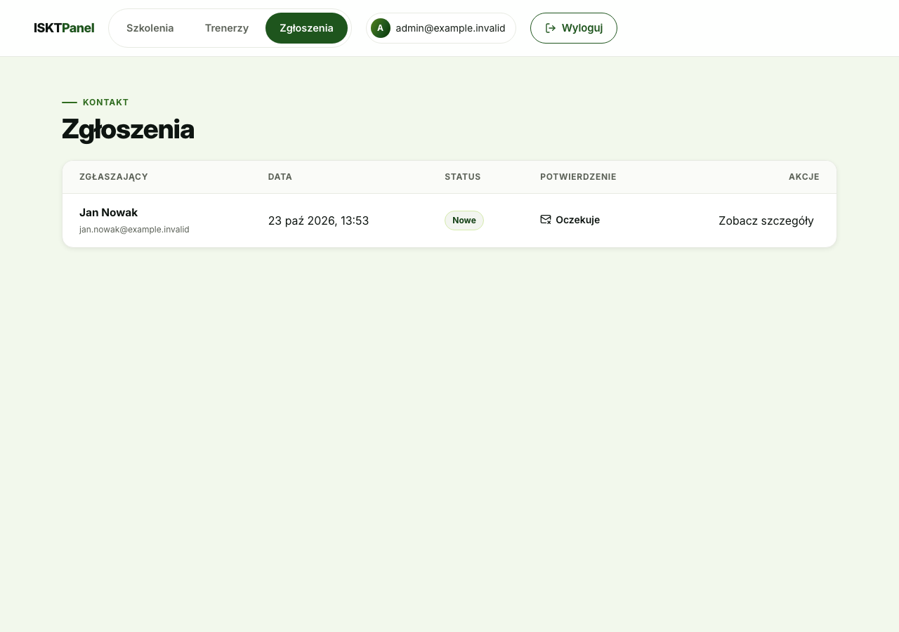

Wybierz **Zobacz szczegóły**. Na stronie zgłoszenia znajdziesz:

- kartę **Dane kontaktowe** — e-mail (klikalny), telefon, firmę i temat;
- kartę **Powiadomienie e-mail** — stan wysyłki, a przy udanej wysyłce także jej czas. Na szczegółach stany mają dłuższe nazwy niż na liście: **Oczekuje na wysyłkę** i **Wysyłka nieudana**;
- kartę **Treść zgłoszenia** — wiadomość nadawcy;
- kartę **Notatka wewnętrzna** (patrz niżej);
- sekcję **Zmień status**.

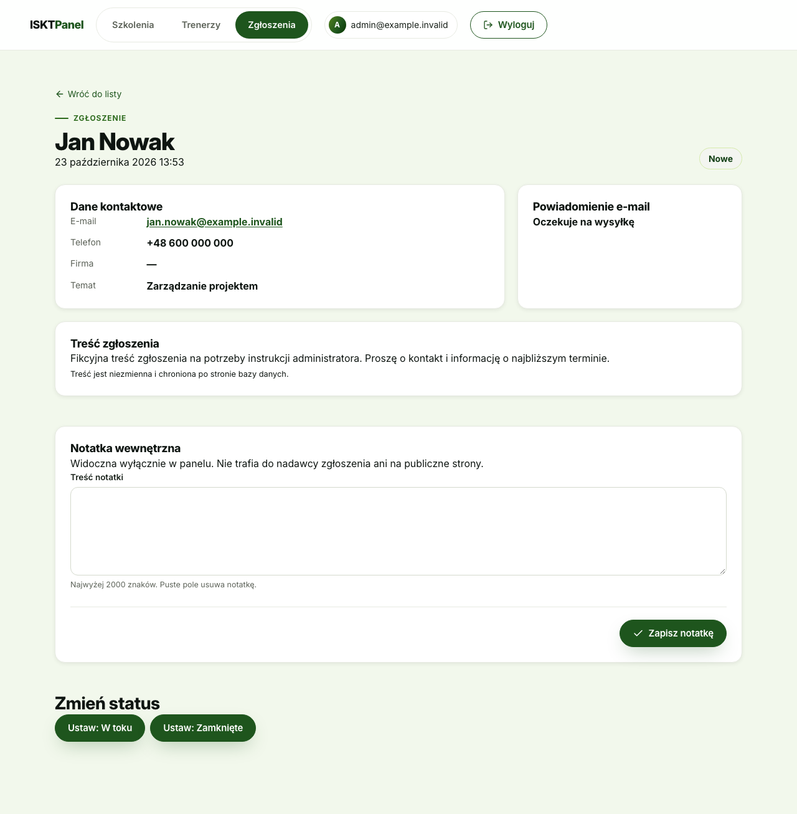

### Notatka wewnętrzna

Do każdego zgłoszenia możesz dopisać notatkę na użytek zespołu. Jest **widoczna wyłącznie w panelu** — nie trafia do nadawcy zgłoszenia ani na publiczne strony.

1. W karcie **Notatka wewnętrzna** wpisz treść w polu **Treść notatki**. Limit to 2000 znaków.
2. Wybierz **Zapisz notatkę**. Nad kartą pojawi się pasek potwierdzenia.
3. Zapisanie **pustego** pola usuwa notatkę.

Notatka opisuje zwykle osobę, która złożyła zgłoszenie — obowiązują ją te same zasady co treść zgłoszenia (§6). Nie wpisuj tam danych, których nie wpisałbyś do akt sprawy.

### Cykl obsługi

1. Nowe zgłoszenie ma status **Nowe**.
2. Gdy zaczynasz je obsługiwać, wybierz **Ustaw: W toku**.
3. Po zakończeniu sprawy wybierz **Ustaw: Zamknięte**.
4. Zgłoszenie, które nie wymaga obsługi (na przykład spam), możesz zamknąć od razu ze statusu **Nowe** — bez przechodzenia przez „W toku”.

Panel pokazuje tylko te przyciski, które są w danym momencie dozwolone.

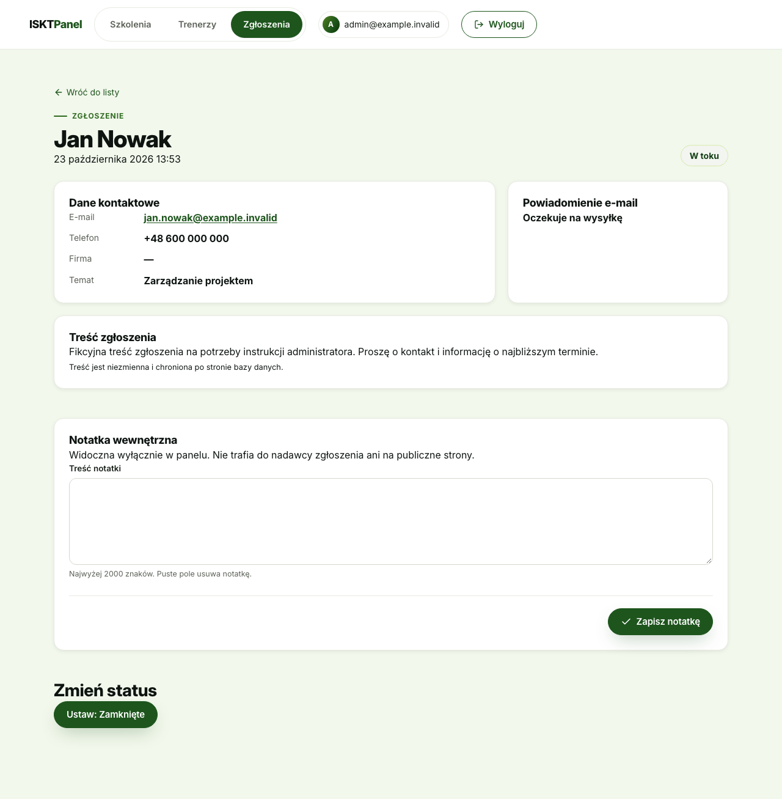

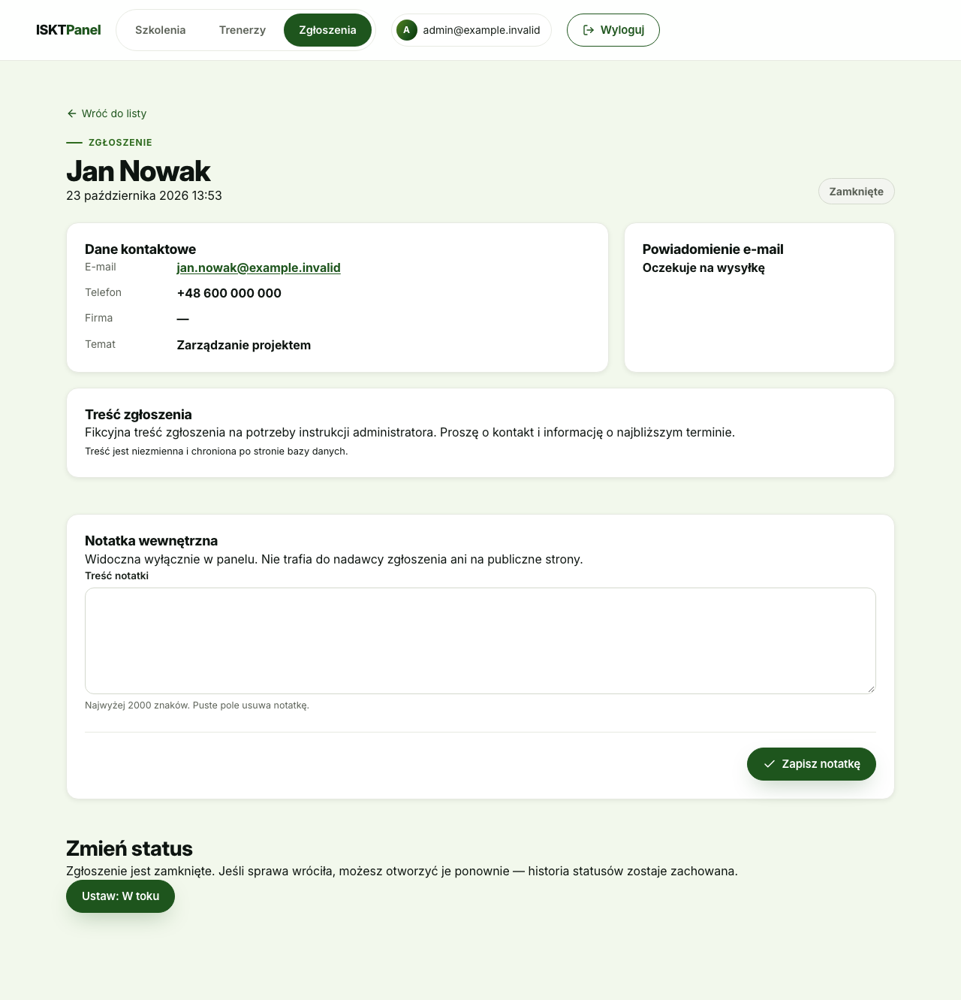

Zamknięte zgłoszenie można otworzyć ponownie: wybierz **Ustaw: W toku**, gdy sprawa wróciła. Nie da się natomiast cofnąć zgłoszenia do statusu **Nowe** — każda zmiana statusu zapisuje się w historii, więc przebieg sprawy pozostaje odtwarzalny. Treści zgłoszenia nie można edytować na żadnym etapie; jest niezmienna i chroniona po stronie bazy danych. To celowe: panel zachowuje dokładnie wiadomość wysłaną przez nadawcę, dzięki czemu historia sprawy pozostaje wiarygodna. Notatka wewnętrzna jest jedynym polem, które przy zgłoszeniu możesz zmieniać.

## 6. Dane osobowe w zgłoszeniach

Zgłoszenia zawierają dane osobowe. Stosuj zasady zatwierdzone w bramce zgodności E8:

- przechowuj zgłoszenia przez 12 miesięcy;
- pracuj na nich w panelu;
- nie kopiuj danych do prywatnych notatek, arkuszy ani innych narzędzi poza panelem;
- nie przesyłaj treści zgłoszeń dalej osobom, które nie obsługują danej sprawy.

Ta sekcja jest praktycznym przypomnieniem ustaleń E8, a nie nową poradą prawną.

## 7. Czego panel nie robi

Panel MVP nie obsługuje:

- płatności ani faktur;
- rezerwacji miejsc;
- kont uczestników;
- newslettera;
- wysyłania plików i zdjęć z komputera (zdjęcia podaje się jako adres URL);
- modułu aktualnych naborów;
- rozbudowanego programu szkolenia (sekcje z punktami);
- usuwania kategorii.

Jeśli osoba zainteresowana chce zapisać się lub zapłacić, obsłuż ten krok poza panelem zgodnie z aktualnym procesem ISKT.

## 8. FAQ

### Nie mogę się zalogować. Co zrobić?

Sprawdź oba pola — przy błędzie formatu komunikat pojawia się przy konkretnym polu. Po odrzuconej próbie logowania oba pola są czyszczone, więc wpisz adres i hasło od nowa. Gdy problem pozostaje, poproś opiekuna technicznego o sprawdzenie uprawnień konta.

### Szkolenie jest zapisane, ale nie ma go w katalogu.

Sprawdź status. **Szkic** jest widoczny tylko w panelu. Użyj **Publikuj**, a potem odśwież publiczny katalog. Sprawdź też, czy kategoria szkolenia jest opublikowana.

### Po publikacji nadal widzę starą wersję.

Odśwież publiczną stronę. Zmiana zwykle jest widoczna przy następnym otwarciu. Strony odświeżają się także automatycznie co 5 minut.

### Jak wrócić na pulpit?

Kliknij **ISKT Panel** w lewym górnym rogu. Pulpit nie jest osobną pozycją w nawigacji — nawigacja ma trzy pozycje: Szkolenia, Trenerzy, Zgłoszenia.

### Nie widzę wszystkich pozycji nawigacji na telefonie.

Na wąskim ekranie pozycje nawigacji **przechodzą do kolejnego wiersza** i są widoczne wszystkie — nie trzeba nic przesuwać. Jeśli widzisz tylko część, odśwież stronę.

### Nie widzę wszystkich kolumn tabeli na telefonie.

Przesuń tabelę poziomo wewnątrz jej ramki. Poniżej ok. 768 px panel pisze nad tabelą wprost: „Tabelę można przewijać w poziomie — kolumna «Akcje» jest po prawej stronie”. Cień przy krawędzi pokazuje, w którą stronę da się jeszcze przewinąć. Cała strona nie przesuwa się na boki — przewijana jest sama tabela. Tabelę da się przewinąć także z klawiatury: wejdź w nią Tabem i użyj strzałek.

### Zdjęcie trenera nie pojawia się.

Sprawdź, czy wpisany adres jest pełnym publicznym adresem URL rozpoczynającym się od `https://`. Panel nie przesyła plików i nie pokazuje podglądu zdjęcia — poprawność adresu zweryfikujesz, otwierając go w nowej karcie. Bez adresu profil działa poprawnie bez zdjęcia.

### Czy notatkę wewnętrzną widzi nadawca zgłoszenia?

Nie. Notatka jest widoczna tylko w panelu i nie trafia ani do nadawcy, ani na publiczne strony.

### Kliknąłem kosz przy złym wierszu.

Nic się nie stało — kosz tylko otwiera pytanie w tym wierszu. Wybierz **Anuluj** albo naciśnij **Escape**. Usunięcie następuje wyłącznie po wybraniu **Tak, usuń trwale**.

### E-mail przy zgłoszeniu ma status „Błąd wysyłki”.

Zgłoszenie nadal znajduje się w panelu i można je obsłużyć. Przekaż błąd opiekunowi technicznemu; nie kopiuj całej treści ani danych osobowych do wiadomości — wystarczy identyfikacja zgłoszenia i czas zdarzenia.

## 9. Uwagi do interfejsu przekazane zespołowi

Co V1 zamknęło (te zastrzeżenia z poprzedniej wersji instrukcji **już nie obowiązują**):

- panel nie jest już osadzony w publicznym nagłówku i stopce — ma własną powłokę;
- **Usuń** ma pytanie o potwierdzenie z obsługą Escape i powrotem fokusu;
- po zapisie pojawia się pasek potwierdzenia ogłaszany przez czytnik ekranu;
- nawigacja panelu zawija się na wąskim ekranie, więc żadna pozycja nie wychodzi poza ekran;
- tabele mają widoczną podpowiedź o przewijaniu i cień przy krawędzi;
- drobny tekst w tabelach spełnia wymóg kontrastu (ok. 6,4:1).

Co pozostaje do rozważenia:

1. Etykieta **Slug** nie ma objaśnienia ani automatycznego tworzenia na podstawie tytułu lub nazwiska.
2. Pole **URL zdjęcia** nie pokazuje podglądu ani osobnego komunikatu, gdy zewnętrzny obraz jest niedostępny.
3. Kategorii nie można usunąć z panelu — da się je tylko wycofać.
4. Rozbudowany program szkolenia nie ma pola w panelu.

## 10. Zrzuty ekranu

Wszystkie 18 zrzutów w katalogu `images/` pochodzi z 2026-10-23 i pokazuje panel w wersji V1 (`main` @ `9ae7205`). Poprzedni zestaw był z 2026-10-09 — przeżył cały redesign i nikt tego nie zauważył, bo nic nie wiąże obrazków z kodem.

Dlatego zestaw nie jest już robiony ręcznie. Odtwarza go jedna komenda — `tests/e2e/zrzuty-instrukcji.spec.ts` przechodzi tę samą ścieżkę co instrukcja i zapisuje wszystkie 18 plików pod ich obecnymi nazwami:

```bash
INSTRUKCJA_DIR=docs/instrukcja-administratora/images \
PLAYWRIGHT_USE_BUILD=1 npx playwright test zrzuty-instrukcji --workers=1
```

Wymaga uruchomionego lokalnego środowiska z danymi `[DEMO]` (patrz `docs/runbook/lokalne-uruchomienie.md`). Bez zmiennej `INSTRUKCJA_DIR` ten plik testowy jest pomijany, więc zwykły przebieg CI nie nadpisuje dokumentacji. `PLAYWRIGHT_USE_BUILD=1` jest istotne: `next dev` dokłada własną nakładkę błędów, która trafiłaby na zrzut.

Przebieg zakłada własne dane demonstracyjne (trenerka „Anna Kowalska”, szkolenie „Zarządzanie projektem”, zgłoszenie od „Jana Nowaka”) i kasuje je po sobie, więc nie zostawia śladu w bazie. Wszystkie dane są fikcyjne, a adresy e-mail w zarezerwowanej domenie `example.invalid`.

**Po każdej zmianie wyglądu panelu uruchom tę komendę ponownie** — inaczej instrukcja znów zacznie pokazywać produkt, którego nie ma.
